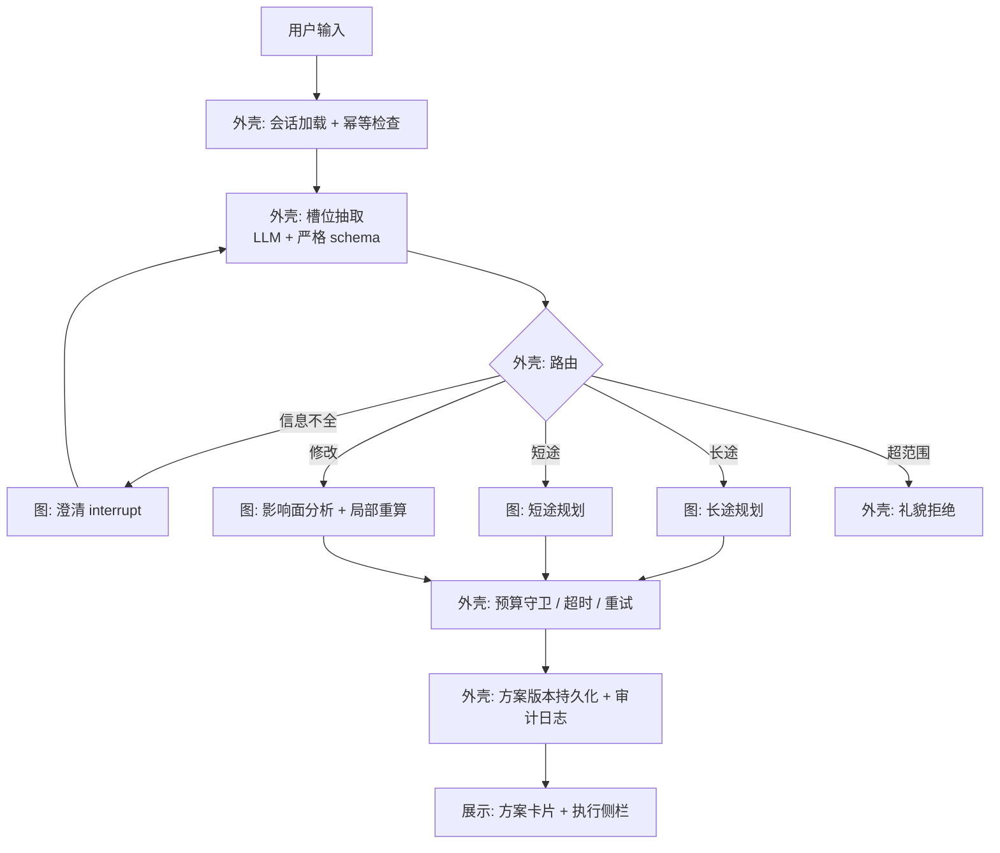
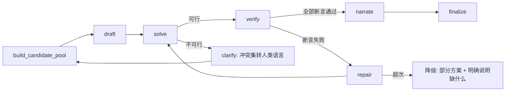

# 架构设计

> 术语以 [CONTEXT.md](../CONTEXT.md) 为准；产品约束见 [prd.md](./prd.md)；决策理由见 [docs/adr/](./adr/)。
> 本文件描述**实现形态**，是唯一允许讨论技术细节的设计文档。

---

## 1. 为什么是两层

一个出行规划的请求里，既有**确定性的控制**（谁在调用、是否重复提交、超时怎么办、花了多少钱、方案有几个版本），也有**动态的判断**（去哪几个地方、怎么排、方案怎么讲）。

把这两类混在一张图里会得到两个后果：控制逻辑无法单测，动态决策被控制逻辑的复杂度淹没。因此：

- **编排外壳**（普通代码）：确定、可单测、可审计、负责恢复与权限。
- **规划图**（图编排）：只承载需要运行时判断的部分。

图编排框架的边界因此被刻意收窄——它不是应用的骨架，而是骨架里的一个零件。



---

## 2. 编排外壳的职责

| 职责 | 为什么必须在图之外 |
|---|---|
| 会话与幂等 | 同一请求重复提交必须返回同一方案版本，这要求在图开始之前就有确定性的判定 |
| 槽位抽取与 schema 校验 | 模型输出格式不对需要重试；格式问题不应污染图状态。**注意**：这里的校验指模型输出的格式，**不含**「缺哪些业务槽位」——完整性判定决定图的分支走哪条边，所以它是图里的节点（见下一节） |
| 路由 | 纯规则判定，可穷举单测；放进图会让「为什么走了这条路」无法审计 |
| 超时 / 重试 / 退避 / 熔断 | 与业务无关的通用策略，必须集中且可配置 |
| 预算守卫 | 计数与熔断是横切关注点；放在图内会随节点增减而漏算 |
| 版本持久化与审计 | 每一次方案产出都要落版本与事件日志，是「可回溯」的实现基础 |
| 数据路径开关 | 真实 / 离线实现的切换是环境配置，不是运行时决策 |
| 并发与限流 | 上游接口有严格配额，限流必须全局生效 |

**外壳可单测**：每个职责都有纯函数式的单元测试，不启动模型、不联网。

---

## 3. 规划图的节点

| 节点 | 类型 | 作用 |
|---|---|---|
| `check_completeness` | 确定性代码 | 按代码里的必需槽位规则判定缺什么；图中第一个分叉点 |
| `clarify` | 中断点 | 信息不全或不可行时向用户提问：挂起等答复，答复按键回填槽位后回到判定；答不全就再问一轮（图中的澄清循环） |
| `resolve_place` | 工具 | 把地名解析为候选区域与坐标，缩小后续检索范围（配额敏感） |
| `build_candidate_pool` | 并行扇出 | 同时取：地点候选、跨城交通候选、住宿区域候选、天气、攻略检索 |
| `draft` | 模型 | 在候选池内提出初步归属（哪天去哪几个），不做时间编排 |
| `solve` | 求解器 | 在硬约束下求出可行的时间与顺序安排；不可行则返回冲突集 |
| `verify` | 确定性代码 | 执行全部红线断言；失败则进入修复 |
| `repair` | 模型 + 求解器 | 依据冲突集或断言失败原因局部重排，限次 |
| `narrate` | 模型 | 基于**已可行的**安排生成解说、注意事项、备选提示 |
| `finalize` | 确定性代码 | 生成方案版本、写入审计、组装展示数据 |

**关键分工**：`draft` 决定「去哪几个」，`solve` 决定「怎么排」，`narrate` 决定「怎么讲」。三者不可互相越权——尤其 `narrate` 只能描述已经过 `verify` 的方案。

### 3.1 长途主线的边



- `clarify` 是**中断点**：状态被持久化，用户答复后从断点继续，不重跑已完成的检索。
- `repair` 有次数上限；超限走**降级**：交付一个明确标注缺口的方案，而不是假装成功。

### 3.2 修改主线的边


**验收要求**：影响面之外的内容在版本 diff 中逐字节不变；影响面之外不产生新的工具调用。

---

## 4. 约束求解的建模

求解器的输入是候选池与硬约束，输出是可行安排或冲突集。

**决策变量**：每个候选地点是否入选、属于哪一天、在该天的第几位；每日的住宿区域；跨城交通班次选择。

**硬约束**（任何一条不可满足即整体不可行）：
预算上限；每日时间窗与总时长；地点营业时间；移动段耗时（来自工具的真实路径或离线估算）；单日移动总时长上限；返程可达；同行人体力上限（如儿童步行总量）。

**软偏好**（进入目标函数，以权重体现）：地理聚集度、兴趣匹配、节奏均匀、饮食偏好、室内外搭配。

**冲突集是核心产出之一**：不可行时，求解器必须返回**最小冲突约束集合**，而不是「无解」。这个集合被翻译成一次带选项的澄清 —— 这是把求解器的失败转成产品体验的关键一步，也是多数同类产品缺失的一环。

**限时策略**：首版把问题限定在「单日指派 + 顺序」，跨日容量与住宿区域先做启发式；求解时限与超时回退路径必须在第一版就存在，避免 W3 失控。

---

## 5. 确定性校验器

求解器保证「排出来的安排成立」；校验器保证「跨系统边界的地方干净」。二者互补，不重复。

校验器执行 [prd.md §7.1](./prd.md) 的八条断言，其中最关键的一条是 **A1 零虚构地名**：方案中每个停靠点必须能在候选池里按 ID 命中。这条断言把「不要幻觉」从提示词纪律变成类型级别的约束。

校验器是纯函数、无网络依赖，因此可以在 CI 中对历史方案批量回归。

---

## 6. 多 Agent 的边界

**保留的角色**：
- **候选筛选者**：从庞大的工具返回中按软偏好筛选与排序，输出一个**小**候选池（配额现实要求候选池必须小）。
- **解说者**：把已验证的安排写成自然语言。它不允许引入新的地名。
- **影响面分析者**：判断一次修改必须重算哪些部分。

**刻意不设的角色**：交通专家 / 住宿专家 / 活动专家。理由：组合决策已由求解器承担，三个独立角色会各自给出局部最优、彼此冲突，而且**无法证明其收益**。

**门禁**：多 Agent 形态的保留与否由 [prd.md §7.3](./prd.md) 的消融 B 组决定。若双 Agent 相对单 Agent 没有可观收益，代码与文档一并降级为单 Agent，并把这个结论写进 README。这是本项目的明确立场：**角色数量不是架构价值**。

---

## 7. 数据访问层

**统一接口**（两类实现）：
`search_place` / `resolve_place` / `route` / `weather` / `train_schedule` / `lookup_area`

| 实现 | 用于 | 数据来源 |
|---|---|---|
| 真实实现 | 演示、抽样验证 | 地图服务官方 MCP；社区只读票务接口 |
| 离线实现 | 开发、回归评测、CI、断网 | 许可明确的开放数据集 + 免费天气接口 + 距离估算 |

**纪律（对应产品红线，不是建议）**：
1. **永不落库真实接口返回的地点数据**（条款禁止平台外缓存与存储）。
2. **两类数据物理不混存**：离线数据集只放许可明确的开放数据，不与真实接口数据合并成同一张表。
3. **每条结果带来源标记**，且来源随方案一路传递到界面。
4. 离线实现的结果必须带「示例数据」标记与时间戳。

切换靠环境变量，演示与评测走同一条代码路径 —— 这是「评测结果能代表线上行为」的前提。

---

## 8. 模型接入层

模型是外部依赖里最不可靠、也最容易悄悄变化的一个。本层把它收进一个窄接口：
**出行需求原文 → 槽位 dict**（`src/llm/`）。

**只暴露一个能力。** 图与外壳都不需要知道用的是哪家模型；换供应商只改三个环境变量
（`LLM_API_KEY` / `LLM_BASE_URL` / `LLM_MODEL`）。`src/llm/extractor.py` 是**全项目
唯一 import `openai` 的地方**。

**依赖注入在这里是必需的，不是风格偏好。** `build_graph(extractor=...)` 把模型调用
从图里推到入口处。代价是 builder 的签名多了一个参数；换来的是**没有 API key 的机器
也能构建并跑通整张图**——全部测试 0.23 秒跑完、不联网。

**当前供应商：DeepSeek `deepseek-flash`**（OpenAI 兼容）。选型本身不是重点，
但它的三个特性改变了代码，必须写下来：

| 特性 | 后果 |
|---|---|
| **思考模式默认打开**（effort 默认 `high`） | 结构化抽取不需要思维链，显式关闭：`extra_body={"thinking": {"type": "disabled"}}`。开着更慢更贵 |
| **思考模式下 `temperature` / `presence_penalty` / `frequency_penalty` 静默失效**——设置不报错，只是不生效 | 靠这些参数调行为会得到无法解释的结果。本项目不传 `temperature` |
| **JSON Output 官方承认「有概率返回空 content」**，且必须设 `max_tokens` 防截断 | 「空响应」与「被截断」都是**预期内失败**，不是异常——两者的处理方式还不一样 |

**失败处理分成两类，这个区分是刻意的：**

| 失败 | 处理 | 为什么 |
|---|---|---|
| 空响应 / JSON 不合法 / schema 不通过 | **带上具体错误重试一次** | 模型能自我纠正：回灌「days 必须是整数」远比回灌「失败了」有效 |
| 输出被 `max_tokens` 截断 | **不重试，直接失败** | 重试只会再截断一次、再花一次钱。这是配置问题，改配置才有用 |
| 两次都失败 | **抛 `ExtractionError`，不静默降级** | 静默返回空槽位会让 Agent 去问用户「出发城市是哪里」——而用户刚刚说过。与红线 R8 同类 |

**提示词里的 JSON Schema 由 schema 生成**（`json_schema_for_prompt()`），所以加字段时
提示词会自动跟上。这条由测试守着——「schema 改了、提示词忘了改」是没法靠人眼发现的漂移。

## 9. 检索增强的三个落点

检索增强在本项目里不是「一个 RAG 模块」，而是三个用途不同的落点。之所以要拆开，是因为它们的语料、更新频率与失效后果都不同。

> 注意区分两个正交的说法：**事实通道 / 知识通道**（[CONTEXT.md](../CONTEXT.md)）划的是数据能不能进向量库；本节三个落点划的是检索被用在流程的哪一步。

| 落点 | 语料 | 服务于 | 什么时候做 |
|---|---|---|---|
| **① 攻略知识** | 许可明确的开放旅行文本（中文可得性待核实） | 每日主题、氛围描述、避坑提示 | 候选池构建时 |
| **② 出行者画像与历史方案** | 本项目自产（结构化 + 向量） | 候选筛选与排序、修改时的默认值 | 每次规划，与候选池并行 |
| **③ 地点语义** | 离线数据集的文本字段（名称、类型、简介） | 补足结构化检索的召回——「适合小孩的室内场所」这类无法用关键词精确表达的意图 | 候选池构建时 |

**检索策略**：混合检索（关键词 + 向量）后接重排；每段被采用的文本必须回传来源片段，供界面溯源。

**明确的反模式**：
- 不把结构化事实（地点存在性、坐标、路线时长、营业时间）放进向量库——那会毁掉红线的可追溯性，事实只能走工具调用。
- 不用检索去回答实时性问题（天气、余票）——检索给不出时效保证。

**降级路径（已识别风险）**：中文开放攻略语料可能不足。若核实后确认不足，则落点 ① 退化为「模型生成 + 明确标注为非检索来源」，检索重心移到 ② 与 ③ 两个自产语料通道。这两个通道不依赖任何外部语料，因此无论外部语料结论如何，检索增强的学习与展示目标都不会落空。

## 10. 状态与记忆

| 层 | 内容 | 生命周期 |
|---|---|---|
| 会话状态 | 当前槽位、图中断点、已完成节点 | 单次会话；中断时持久化 |
| 方案版本 | 每次定稿的方案全量快照 + 变更清单 | 永久；永不删除旧版本 |
| 出行者画像 | 稳定的软偏好（节奏、口味、预算习惯、常驻位置） | 跨会话；仅影响软偏好 |
| 检索索引 | 离线语料向量 + 地点语义向量 | 随数据集重建 |

**画像的纪律**：画像只能影响软偏好。任何硬约束（预算上限、时间窗）必须来自本次会话的明示输入，不许从画像「推断」——否则用户会发现系统在替自己降低标准。

---

## 11. 可观测性与成本

- **追踪**：每个图节点、每次工具调用、每次求解都产生一条 span，串联成一个需求 ID 的完整轨迹。**每条失败用例必须能定位到「输入 / 检索 / 提示词 / 编排 / 求解」中的某一层**，这是 badcase 迭代链的技术前提。
- **成本分桶**：输入、输出、检索、重排、工具调用、重试。分桶记录才能回答「钱花在哪」。
- **预算守卫**：单次请求的模型调用次数与工具调用次数上限；超限走降级而不是静默失败。
- **配额守卫**：上游接口的每日调用计入本地账本，接近上限时自动切离线路径并提示。

---

## 12. 目录结构（建议）

```
├── CONTEXT.md              # 词汇表（唯一语言来源）
├── docs/
│   ├── prd.md
│   ├── architecture.md
│   ├── adr/
│   └── research/           # 调研报告与依据
├── src/
│   ├── llm/                # 模型接入：配置、schema、提示词、抽取器（唯一 import openai 的地方）
│   ├── shell/              # 编排外壳：会话、路由、幂等、守卫、审计（纯逻辑 + 单测）
│   ├── graph/              # 规划图：节点与边
│   ├── solver/             # 约束建模与求解
│   ├── verify/             # 红线断言
│   ├── data/               # 数据访问接口 + 真实实现 + 离线实现
│   ├── memory/             # 画像、方案版本、检索索引
│   └── web/                # 界面与流式接口
├── eval/
│   ├── cases/              # 回归集（隐藏挑战集不入库）
│   ├── assertions/         # 红线断言
│   └── report/             # 带口径的指标表
└── demo/                   # 可现场演示的样例需求与结果
```

---

## 13. 与产品文档的对应

| 产品要求 | 架构落点 |
|---|---|
| 红线 R1 / R2 无虚构地名 | §5 校验器 A1 + §7 来源标记 + 候选池约束 |
| 红线 R3–R5 住宿与票务边界 | §7 数据层 + 界面展示约束 |
| 红线 R8 不可行必须澄清 | §4 冲突集 → §3 `clarify` 中断点 |
| 修改不重算全局 | §3.2 影响面 |
| 评测闭环 | §5 纯函数校验器 + §10 追踪 |
| 多 Agent 的存在理由 | §6 门禁 + 消融 B 组 |
| 检索增强的学习与展示目标 | §9 三个落点；其中 ②③ 不依赖外部语料 |
| 抽取失败不静默降级 | §8 模型接入层（失败分两类）+ 节点的失败模式注释 |
