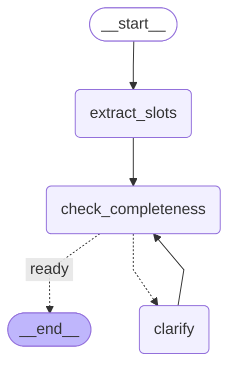

# 规划图（自动生成）

> ⚠️ **本文件由脚本生成，不要手改。** 改图或改状态之后重新运行：
>
> ```bash
> python -m scripts.export_graph
> ```
>
> - 生成时间：2026-10-10 16:38:59
> - 生成自提交：`58fbd62`（生成时代码有未提交改动，本文件可能与你看到的代码不一致）
> - 内容全部从代码推导；本文件里没有任何手写的节点名或字段名

## 一、拓扑

由框架从代码现算，因此不会过期。内部通道（`__start__`、`branch:*`）已过滤。



## 二、状态通道

语义由框架的通道类型决定，不是约定：挂了 reducer 的字段才会「合并」，
其余字段一律整体覆盖。

| 字段 | 合并语义 | 说明 |
|---|---|---|
| `candidates` | **合并** | merge_candidates |
| `clarify_question` | **覆盖** | 后写的整体替换先写的 |
| `missing_slots` | **覆盖** | 后写的整体替换先写的 |
| `raw_request` | **覆盖** | 后写的整体替换先写的 |
| `slots` | **覆盖** | 后写的整体替换先写的 |

> **本表刻意没有「写入者 / 读取者」两列。** 它们需要对节点做静态分析或运行期
> 埋点，框架不提供。靠人读代码填的列会随代码漂移——宁可少一列，也不要一列
> 看起来权威却没人维护的数据。将来要补，正确做法是在节点上加埋点，而不是手填。

## 三、节点

| 节点 | 文档字符串首行 |
|---|---|
| `check_completeness` | 判定槽位够不够开始规划，并把缺失项写进状态。 |
| `clarify` | 向用户提问并挂起，等答复后把答复回填进槽位。 |
| `extract_slots` | 把出行需求原文抽成结构化槽位。 |

## 四、状态形状（输入 JSON Schema）

<details>
<summary>展开</summary>

```json
{
  "description": "规划图的共享状态。\n\n字段分两类，写法完全不同；判断依据是「这个字段会不会被多个节点同时写」：\n\n- **裸字段（覆盖型）**：后写的整个替换先写的。节点想保留历史必须自己拼回去。\n- **挂 reducer 的字段（合并型）**：由 reducer 决定新旧值怎么合。\n\n`total=False` 是必需的：图启动时只需要部分字段，而 TypedDict 默认要求所有键\n都存在，否则类型检查会要求每个调用点把全部字段都填上。",
  "properties": {
    "raw_request": {
      "title": "Raw Request",
      "type": "string"
    },
    "slots": {
      "additionalProperties": true,
      "title": "Slots",
      "type": "object"
    },
    "missing_slots": {
      "items": {
        "additionalProperties": true,
        "type": "object"
      },
      "title": "Missing Slots",
      "type": "array"
    },
    "clarify_question": {
      "title": "Clarify Question",
      "type": "string"
    },
    "candidates": {
      "items": {
        "additionalProperties": true,
        "type": "object"
      },
      "title": "Candidates",
      "type": "array"
    }
  },
  "title": "TripState",
  "type": "object"
}
```

</details>
